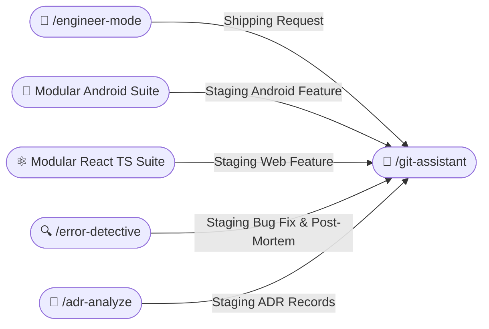

# 🌿 Git Assistant Skill (/git-assistant)

The **Git Assistant Skill** is a safety-first version control operator. It coordinates atomic commit staging, conventional commit formatting, branch management, safe rebasing, merge conflict resolution, and PR briefing creation without risking code loss.

---

## 🧭 Connected Skills & Inter-Skill Routing



---

## 🛡️ 1. Core Git Safety Principles

1. **Mandatory User Confirmation Before Push / Merge (Zero Auto-Push Policy)**:
   - **NEVER AUTO-PUSH**: The agent must **NEVER** automatically execute `git push`, `git merge`, or open/merge pull requests without explicitly presenting the action and proposed changes to the user and asking for confirmation first.
   - Always prompt the user with interactive options before running any push or merge command:
     ```markdown
     ### 🌿 Git Assistant: Confirmation Required

     The following changes are staged/committed on branch `<branch>`:
     - **Latest Commit**: `<hash>` `<commit message>`
     - **Remote Target**: `origin/<branch>`

     **How would you like to proceed?**
     - [A] **Push to Remote** (`git push origin <branch>`)
     - [B] **Push and Create Pull Request / Merge**
     - [C] **Keep Changes Local Only** (Do not push)
     ```
   - Execution of any push or merge operation **MUST pause and await the user's explicit approval**. If the user selects [C] or declines, keep all commits local only.
2. **Never Force Push Blindly**: Prohibit raw `git push --force`. Always use `git push --force-with-lease` only when explicitly rebasing personal feature branches. Never force-push to `main` or `develop`.
3. **Never Blindly `git add .`**: Always inspect `git status` and stage related files intentionally (`git add <file1> <file2>`) to prevent committing temporary build artifacts, credentials, or `.DS_Store` files.
4. **Safety Backup Tags Before Destructive Operations**: Prior to running rebases or complex merges, create a temporary reference tag (`git tag backup/pre-rebase-$(date +%s)`).

---

## ✍️ 2. Conventional Commits Standard

Format all commit messages according to the Conventional Commits specification:

```text
<type>(<scope>): <short imperative description>

[Optional detailed body explaining the 'why' and architectural rationale]

[Optional footer: Closes #123, Refs #456]
```

### Supported Types:
- **`feat`**: A new feature for the user or consumer.
- **`fix`**: A bug fix (often linked with `/docs/error-fix/` report).
- **`refactor`**: Code restructuring without changing external behavior.
- **`perf`**: Performance improvement.
- **`docs`**: Documentation updates or new ADR entries.
- **`test`**: Adding missing tests or correcting existing tests.
- **`chore`**: Tooling, dependencies, or build config changes.

---

## 🔀 3. Safe Syncing & Rebase Protocol

Always pull upstream changes with rebase:
```bash
git fetch origin
git pull --rebase origin main
```

### 3-Way Conflict Resolution Protocol:
When a merge conflict occurs:
1. Identify conflicting files via `git status`.
2. Inspect conflict markers (`<<<<<<< HEAD`, `=======`, `>>>>>>>`).
3. Explain the conflict to the developer clearly:
   - What the local branch changed.
   - What the incoming remote branch changed.
4. Merge both intents cleanly without deleting valid changes.
5. Re-run local test suites to ensure the resolution did not introduce regressions.
6. Continue rebase: `git add <resolved-files> && git rebase --continue`.

---

## 📝 4. Briefing-Style PR Generation

When opening or preparing a Pull Request, generate an executive PR description:

```markdown
## 📋 Summary of Changes
- Implemented Clean Architecture UseCase for user profile caching.
- Added room entity with type-safe schema migration (ADR-0004).

## 🎯 Motivation & Context
Fixes unexpected UI jank during offline launch by introducing reactive Room cache.

## 🔬 Testing Evidence
- `./gradlew testDebugUnitTest` passed (28 tests, 0 failures).
- `./gradlew assembleDebug` succeeded.

## 🔗 Related Documentation
- ADR: [docs/adr/ADR-0004-offline-caching.md](docs/adr/ADR-0004-offline-caching.md)
- Bug Fix Report: [docs/error-fix/2026-10-22-cache-invalidation.md](docs/error-fix/2026-10-22-cache-invalidation.md)
```
