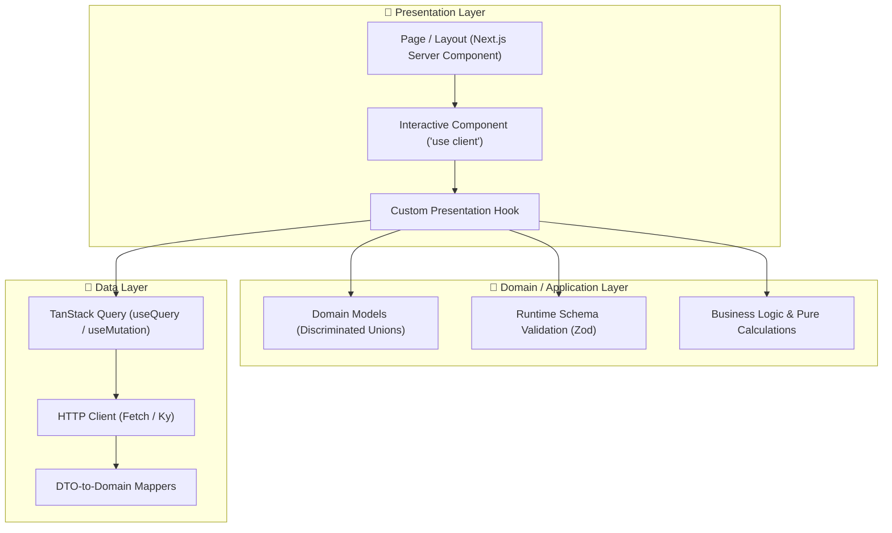

# ⚛️ React + TypeScript Web Skills

Welcome to the **React + TypeScript Web Skills** documentation. This module contains the master **React + TypeScript Expert** (`/react-ts-expert`) skill, providing production standards for React 19, TypeScript 5+, Next.js App Router, Vite, Tailwind CSS, TanStack Query, Zustand, WCAG 2.2 AA accessibility, and Web Vitals performance.

---

## 🧭 Navigation & Connected Skills Hub

| Hub Directory | Domain | Direct Link |
|---|---|---|
| 🏠 **Root Hub** | Full Suite Overview & Installer | [Root README](../README.md) |
| 🚀 **Engineer Mode** | Master Entry Point & Playbook Router | [Engineer Mode README](../engineer-mode/README.md) |
| 📱 **Android Skills** | Kotlin, Compose, Clean Architecture, Google android-cli | [Android README](../android-skills/README.md) |
| 🔍 **Diagnostic Skills** | Error Detective, ADR Detection, App Design | [Diagnostic README](../diagnostic-skills/README.md) |
| 🌿 **Git Skills** | Branching, Safe Rebase, Conflict Resolution, PRs | [Git README](../git-skills/README.md) |

---

## 🏗️ Architecture Blueprint

The skill enforces strict **Frontend Clean Architecture** across web codebases:



---

## 📋 Capabilities & Rule Matrix

| Area | Rule / Standard | Enforcement Detail |
|---|---|---|
| **Type Safety** | Zero-Any Policy | Strict TypeScript 5+, `unknown` with narrowing, `satisfies`, branded types. |
| **State Modeling** | Discriminated Unions | Never disjoint booleans; model `status: 'idle' \| 'loading' \| 'success' \| 'error'`. |
| **Server State** | TanStack Query | Query keys as tuples, configured `staleTime`, optimistic mutation rollbacks. |
| **Client State** | Zustand / Context | Atomic store slices with granular selectors to eliminate unnecessary re-renders. |
| **Styling** | Tailwind CSS / CSS Modules | Mobile-first responsive design, dark mode tokens, strict spacing scales. |
| **Accessibility** | WCAG 2.2 AA Standard | Semantic HTML, full keyboard navigation, focus trap in modals, visible focus rings. |
| **Core Web Vitals** | High Performance | High LCP fetchpriority, zero CLS via explicit dimensions, low INP via transitions. |

---

## ⚡ How to Trigger

You can trigger the React TS Expert directly or via `/engineer-mode`:

```text
/react-ts-expert build a responsive checkout flow with React 19, Zod validation, and Tailwind
```
```text
/react-ts-expert create a typed TanStack Query hook with optimistic updates and caching
```
```text
/react-ts-expert audit this Next.js App Router component for WCAG 2.2 accessibility and INP performance
```

### Connected Skill Hand-offs:
- Encountering a hydration mismatch or TypeScript error? ➔ Routes to [Error Detective](../diagnostic-skills/README.md)
- Making a library choice (e.g. state management or styling framework)? ➔ Routes to [ADR Analyze](../diagnostic-skills/README.md)
- Modeling component hierarchy or state machines? ➔ Routes to [App Design](../diagnostic-skills/README.md)
- Ready to commit and open a PR? ➔ Routes to [Git Assistant](../git-skills/README.md)
