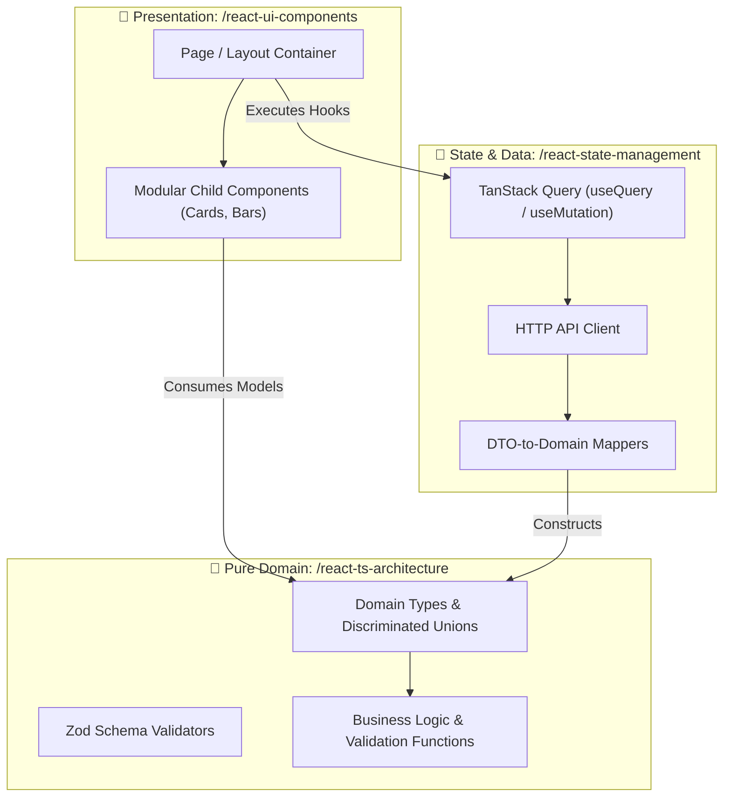

# ⚛️ React + TypeScript Web Skills Suite

Welcome to the **React + TypeScript Web Skills Suite**. Just like our Android suite, this module is decomposed into **4 specialized, modular skills** that enforce enterprise Frontend Clean Architecture, accessible modular UI component decomposition, robust state synchronization, and automated testing with Vitest.

---

## 🧭 Navigation & Connected Skills Hub

| Hub Directory | Domain | Direct Link |
|---|---|---|
| 🏠 **Root Hub** | Full Suite Overview & Universal Installer | [Root README](../README.md) |
| 🚀 **Engineer Mode** | Master Entry Point & Adaptive Playbook Router | [Engineer Mode README](../engineer-mode/README.md) |
| 📱 **Android Skills** | Clean Arch, Compose, MapLibre, Testing, Gradle | [Android README](../android-skills/README.md) |
| 🔍 **Diagnostic Skills** | Error Detective, ADR Detection, App Design, Changelogs | [Diagnostic README](../diagnostic-skills/README.md) |
| 🌿 **Git Skills** | Branching, Safe Rebase, Conflict Resolution, PRs | [Git README](../git-skills/README.md) |

---

## 📦 Modular React TS Skills Matrix

| Skill Directory | Slash Command | Primary Purpose | Deliverables |
|---|---|---|---|
| [**`react-ts-architecture/`**](./react-ts-architecture/README.md) | `/react-ts-architecture` | Enforces Frontend Clean Architecture, pure domain models & Zod schemas (zero DOM code), strict type discipline (zero any, discriminated unions, `satisfies`). | Domain types, validators, typed API clients |
| [**`react-ui-components/`**](./react-ui-components/README.md) | `/react-ui-components` | Accessible modular UI components. Enforces multi-file separation (never 1 giant file), strict prop ordering (data top, className bottom), Tailwind CSS, WCAG 2.2 AA. | Modular component, container, and type files |
| [**`react-state-management/`**](./react-state-management/README.md) | `/react-state-management` | Governs server and client state synchronization. TanStack Query for server caching/optimistic mutations, Zustand for atomic client state slices. | Custom query hooks, mutation handlers, stores |
| [**`react-testing/`**](./react-testing/README.md) | `/react-testing` | Directs automated user-centric testing with Vitest, React Testing Library, and Mock Service Worker (MSW). | Unit, component, and integration test suites |

---

## 🏗️ Architecture Blueprint



---

## 🎨 UI Component Decomposition & Prop Ordering Rules

### 1. Multi-File Decomposition (Never 1 Giant File)
Each web feature must be split into dedicated, cohesive files:
- `CartPage.tsx`: Server Component handling routing and metadata.
- `CartContainer.tsx`: Client component managing state and user events.
- `CartItemCard.tsx`: Isolated presentation card component in `components/`.
- `CartTypes.ts`: Component-specific prop interfaces and view models.

### 2. The Prop Ordering Rule
- **In Component Definition**: Mandatory data and event callbacks MUST be on top; optional configuration, `className`, and `children` must be at the bottom.
- **At the Call Site**: Pass data first, and place long `className` layout styling at the **very bottom of the tag**:

```tsx
// Definition: Data first, className at the bottom
export interface CartItemCardProps {
  item: CartItemModel;
  onRemove: (id: string) => void;
  isHighlighted?: boolean;
  className?: string; // BOTTOM of props
}

// Call site: Data first, className at the VERY BOTTOM
<CartItemCard
  item={cartItem}
  onRemove={(id) => handleRemove(id)}
  isHighlighted={cartItem.isPending}
  className="w-full max-w-xl mx-auto p-4 border rounded-xl"
/>
```

---

## ⚡ How to Trigger

```text
/react-ts-architecture define a domain model and Zod schema for multi-step checkout
```
```text
/react-ui-components create an accessible modal dialog with focus trap and Tailwind CSS
```
```text
/react-state-management build an optimistic cart mutation hook with TanStack Query
```
```text
/react-testing write Vitest tests for the checkout form using MSW network handlers
```
