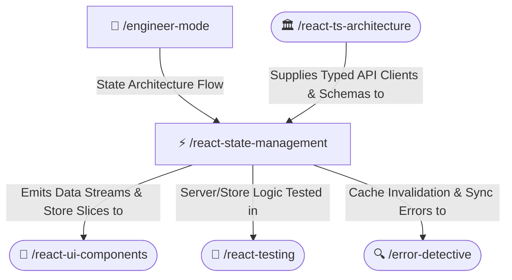

# ⚡ React State Management Skill

Governs server and client state synchronization in React 19 and Next.js. Strictly enforces TanStack Query for server state caching, background invalidation, and optimistic mutations, and Zustand for atomic client state slices.

---

## 🧭 Connected Skills Architecture



---

## 📂 Subfolder Structure

| Path | Purpose | Description |
| :--- | :--- | :--- |
| [`SKILL.md`](./SKILL.md) | Agent Skill Definition | Core prompt instructions and guidelines. |
| [`instructions/guidelines.md`](./instructions/guidelines.md) | Agent Execution Protocol | State boundaries, query key rules, staleTime, and atomic selector usage. |
| [`instructions/examples.md`](./instructions/examples.md) | Production Code Examples | TanStack query hooks, optimistic mutations with rollback, and Zustand store slices. |

---

## 🚀 How to Use

### 1. Direct Skill Activation
Trigger this skill whenever configuring asynchronous API caching, managing client UI state, or handling complex mutation flows:
```text
/react-state-management
```

### 2. Guided via Engineer Mode
Start through the adaptive interactive questionnaire:
```text
/engineer-mode
```
Select **Playbook 03 (React + TypeScript Engineering)**.

---

## 🔗 Related Skills

- [🏛️ React Clean Architecture](../react-ts-architecture/README.md)
- [🎨 React UI Components](../react-ui-components/README.md)
- [🧪 React Testing](../react-testing/README.md)
- [🔍 Error Detective](../../diagnostic-skills/error-detective/README.md)
- [🏠 Master Suite README](../../README.md)
