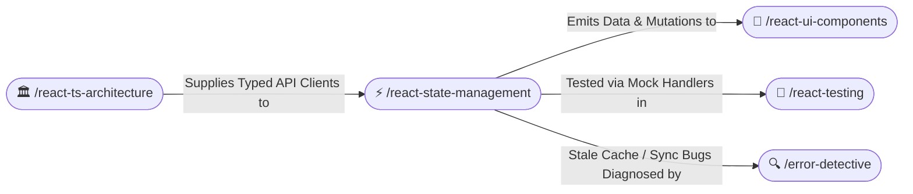

# ⚡ React State Management: TanStack Query & Zustand (/react-state-management)

The **React State Management Skill** directs how asynchronous server state and local client state are partitioned in modern web applications. It eliminates synchronization bugs by establishing TanStack Query as the authority on server data and Zustand as the lightweight engine for global UI state.

---

## 🧭 Connected Skills & Routing



---

## 🌐 1. Server State: TanStack Query (React Query)

### A. Structured Query Keys
Always define query keys as structured tuple constants with type safety:

```typescript
export const cartQueryKeys = {
  all: ['cart'] as const,
  detail: (userId: string) => [...cartQueryKeys.all, 'detail', userId] as const,
  items: (userId: string) => [...cartQueryKeys.detail(userId), 'items'] as const,
};
```

### B. Custom Query Hooks with `staleTime`
Encapsulate queries inside custom hooks. Never rely on zero-second default stale times that trigger excessive background refetches:

```typescript
/**
 * Observes user cart items with automatic background caching.
 *
 * @param userId Unique identifier of the authenticated user.
 */
export function useCartItems(userId: string) {
  return useQuery({
    queryKey: cartQueryKeys.items(userId),
    queryFn: () => fetchCartItems(userId),
    staleTime: 1000 * 60 * 5, // 5 minutes fresh
    gcTime: 1000 * 60 * 30,   // 30 minutes in memory
  });
}
```

### C. Optimistic Mutations with Rollback
When updating UI before server confirmation, always implement an optimistic update with rollback:

```typescript
export function useUpdateCartQuantity() {
  const queryClient = useQueryClient();

  return useMutation({
    mutationFn: ({ itemId, quantity }: { itemId: string; quantity: number }) =>
      apiUpdateQuantity(itemId, quantity),
    onMutate: async ({ itemId, quantity }) => {
      await queryClient.cancelQueries({ queryKey: cartQueryKeys.all });
      const previousCart = queryClient.getQueryData<CartItem[]>(cartQueryKeys.items('current'));

      // Optimistically update cache
      queryClient.setQueryData<CartItem[]>(cartQueryKeys.items('current'), (old = []) =>
        old.map((item) => (item.id === itemId ? { ...item, quantity } : item))
      );

      return { previousCart };
    },
    onError: (_err, _variables, context) => {
      // Rollback on failure
      if (context?.previousCart) {
        queryClient.setQueryData(cartQueryKeys.items('current'), context.previousCart);
      }
    },
    onSettled: () => {
      queryClient.invalidateQueries({ queryKey: cartQueryKeys.all });
    },
  });
}
```

---

## 🎛️ 2. Client State: Lightweight Zustand Stores

Use Zustand strictly for transient client state (e.g. active modal, theme toggle, sidebar collapsed):

```typescript
interface UiState {
  isSidebarOpen: boolean;
  activeModal: string | null;
  toggleSidebar: () => void;
  openModal: (modalId: string) => void;
  closeModal: () => void;
}

export const useUiStore = create<UiState>((set) => ({
  isSidebarOpen: true,
  activeModal: null,
  toggleSidebar: () => set((state) => ({ isSidebarOpen: !state.isSidebarOpen })),
  openModal: (modalId) => set({ activeModal: modalId }),
  closeModal: () => set({ activeModal: null }),
}));
```

### Granular Selector Rule:
Always subscribe to atomic store properties to prevent component re-renders when unrelated properties change:
```tsx
// ✅ Subscribes only to `isSidebarOpen`
const isSidebarOpen = useUiStore((state) => state.isSidebarOpen);
```
