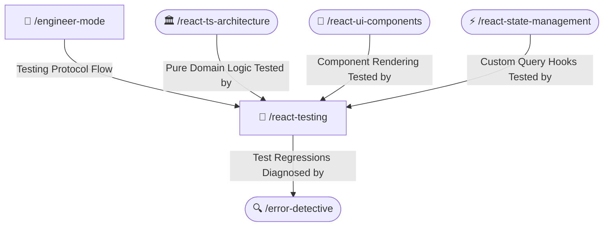

# 🧪 Modern React & TypeScript Testing Skill

Automates unit, integration, and component testing for React 19 and Next.js applications using Vitest, React Testing Library, and Mock Service Worker (MSW). Strictly enforces user-centric accessible queries and deterministic test assertions without testing internal implementation details.

---

## 🧭 Connected Skills Architecture



---

## 📂 Subfolder Structure

| Path | Purpose | Description |
| :--- | :--- | :--- |
| [`SKILL.md`](./SKILL.md) | Agent Skill Definition | Core instructions and rules for the agent. |
| [`instructions/guidelines.md`](./instructions/guidelines.md) | Agent Execution Protocol | Testing rules, accessible role queries, user-event setup, and MSW policies. |
| [`instructions/examples.md`](./instructions/examples.md) | Production Code Examples | Component accessibility tests, pure function unit tests, and MSW handlers. |

---

## 🚀 How to Use

### 1. Direct Skill Activation
Trigger this skill whenever writing test suites, testing React hooks/components, or mocking HTTP responses:
```text
/react-testing
```

### 2. Guided via Engineer Mode
Start through the adaptive interactive questionnaire:
```text
/engineer-mode
```
Select **Playbook 03 (React + TypeScript Engineering)** or **Playbook 07 (Quality & Testing Automation)**.

---

## 🔗 Related Skills

- [🏛️ React Clean Architecture](../react-ts-architecture/README.md)
- [🎨 React UI Components](../react-ui-components/README.md)
- [⚡ React State Management](../react-state-management/README.md)
- [🔍 Error Detective](../../diagnostic-skills/error-detective/README.md)
- [🏠 Master Suite README](../../README.md)
