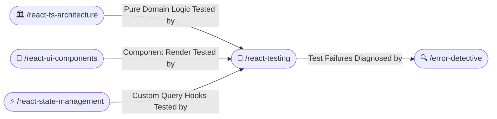

# 🧪 Modern React & TypeScript Testing (/react-testing)

The **React Testing Skill** directs automated unit, component, and integration test engineering across modern web projects. It enforces user-centric testing via Vitest, React Testing Library, and Mock Service Worker (MSW), eliminating brittle implementation-detail testing.

---

## 🧭 Connected Skills & Routing



---

## ♿ 1. Accessibility-Driven Component Testing (React Testing Library)

Always query elements the way end-users and assistive technologies perceive them (using accessible roles and labels rather than brittle CSS selectors or test IDs):

```typescript
import { render, screen } from '@testing-library/react';
import userEvent from '@testing-library/user-event';
import { describe, it, expect, vi } from 'vitest';
import { CartItemCard } from './CartItemCard';

describe('CartItemCard Component', () => {
  const mockItem = {
    id: 'prod_99',
    title: 'Mechanical Keyboard',
    price: 150.0,
  };

  it('renders item details with accessible landmarks', () => {
    render(
      <CartItemCard
        item={mockItem}
        onQuantityChange={vi.fn()}
        onRemoveItem={vi.fn()}
      />
    );

    // Query via role and text
    expect(screen.getByRole('article', { name: /cart item: mechanical keyboard/i })).toBeInTheDocument();
    expect(screen.getByText('Mechanical Keyboard')).toBeInTheDocument();
  });

  it('triggers onRemoveItem callback when remove button is clicked', async () => {
    const user = userEvent.setup();
    const handleRemove = vi.fn();

    render(
      <CartItemCard
        item={mockItem}
        onQuantityChange={vi.fn()}
        onRemoveItem={handleRemove}
      />
    );

    const removeBtn = screen.getByRole('button', { name: /remove item/i });
    await user.click(removeBtn);

    expect(handleRemove).toHaveBeenCalledTimes(1);
    expect(handleRemove).toHaveBeenCalledWith('prod_99');
  });
});
```

---

## 🌐 2. Network Mocking with Mock Service Worker (MSW)

Never mock `fetch` or `axios` directly with crude spies. Use MSW to intercept requests at the network layer:

```typescript
import { http, HttpResponse } from 'msw';
import { setupServer } from 'msw/node';

export const handlers = [
  http.get('/api/cart', () => {
    return HttpResponse.json([
      { id: '1', title: 'Ergonomic Mouse', price: 65.0 },
    ]);
  }),
];

export const server = setupServer(...handlers);
```

---

## 🛡️ 3. Testing Rules & Anti-Patterns

1. **Avoid `fireEvent`**: Always use `@testing-library/user-event` because it simulates real browser interactions (focus, hover, key events).
2. **Avoid Testing Implementation Details**: Do not test internal component state or whether a particular internal helper method was called. Test what the user sees and interacts with.
3. **Deterministic Timers**: When testing debounce or timeouts, use Vitest fake timers (`vi.useFakeTimers()`).
