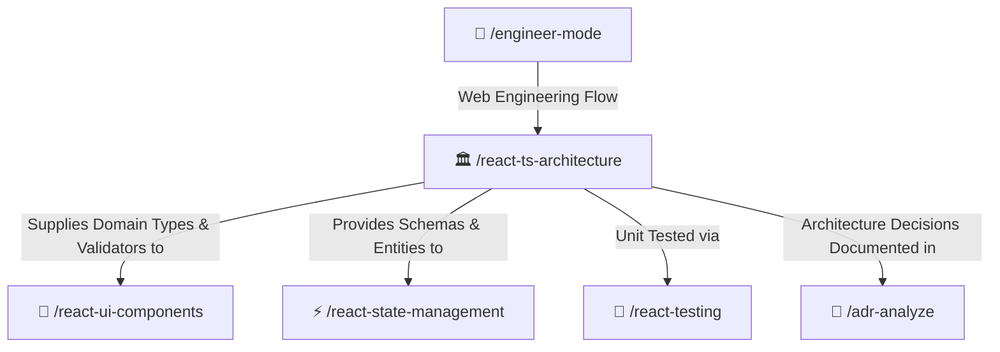

# 🏛️ React & TypeScript Clean Architecture Skill

Enforces enterprise Clean Architecture, pure TypeScript domain models (zero framework/DOM code), strict type discipline (zero `any`, discriminated unions, branded primitives, `satisfies`), and decoupled API service layers.

---

## 🧭 Connected Skills Architecture



---

## 📂 Subfolder Structure

| Path | Purpose | Description |
| :--- | :--- | :--- |
| [`SKILL.md`](./SKILL.md) | Agent Skill Definition | Core instructions and entry points for AI agents. |
| [`instructions/guidelines.md`](./instructions/guidelines.md) | Agent Execution Protocol | Clean layer boundaries, strict zero-any rules, and exhaustive pattern matching. |
| [`instructions/examples.md`](./instructions/examples.md) | Production Code Examples | Real-world TypeScript types, branded IDs, Zod schemas, and DTO-to-Domain mappers. |

---

## 🚀 How to Use

### 1. Direct Skill Activation
Trigger this skill whenever structuring frontend layers, designing domain entities, or refactoring business logic:
```text
/react-ts-architecture
```

### 2. Guided via Engineer Mode
Start through the adaptive interactive questionnaire:
```text
/engineer-mode
```
Select **Playbook 03 (React + TypeScript Engineering)**.

---

## 🔗 Related Skills

- [🎨 React UI Components](../react-ui-components/README.md)
- [⚡ React State Management](../react-state-management/README.md)
- [🧪 React Testing](../react-testing/README.md)
- [📜 ADR Analyzer](../../diagnostic-skills/adr-analyze/README.md)
- [🏠 Master Suite README](../../README.md)
