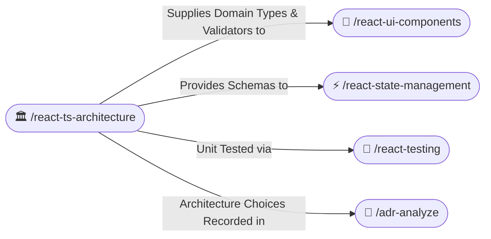
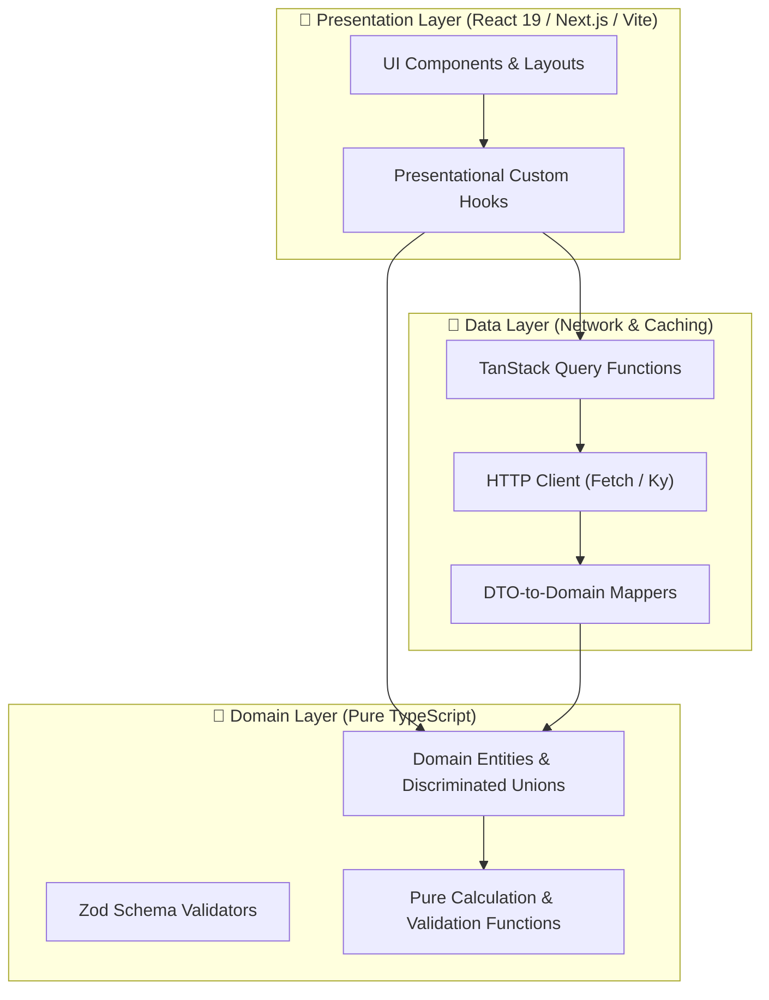

# 🏛️ React & TypeScript Clean Architecture (/react-ts-architecture)

The **React + TypeScript Architecture Skill** establishes enterprise Clean Architecture boundaries across modern web applications. It guarantees that domain business rules remain decoupled from UI components and third-party frameworks, ensuring high testability and predictable data flow.

---

## 🧭 Connected Skills & Routing



---

## 🏗️ 1. Frontend Layer Boundaries



### A. Domain Layer (Pure TypeScript — Zero DOM or UI Imports)
- **Zero DOM Dependencies**: Never import `window`, `document`, React hooks, or styling libraries into the domain layer.
- **Model States via Discriminated Unions**:
  ```typescript
  /** Pure domain representation of asynchronous load states. */
  export type AsyncResult<T> =
    | { readonly status: 'idle' }
    | { readonly status: 'loading' }
    | { readonly status: 'success'; readonly data: T }
    | { readonly status: 'error'; readonly error: Error };
  ```
- **Type-Safe Branded Primitives**:
  ```typescript
  /** Type-safe branded identifier preventing accidental ID mix-ups. */
  export type OrderId = string & { readonly __brand: unique symbol };
  ```

### B. Data & API Layer (DTO Encapsulation)
- Never allow raw backend network responses to leak directly into UI components.
- Validate network payloads at the boundary using schema validators (Zod), and transform into clean domain models using single-expression mappers:
  ```typescript
  export const UserDtoSchema = z.object({
    id: z.string(),
    user_name: z.string(),
    user_email: z.string().email(),
  });

  export type UserDto = z.infer<typeof UserDtoSchema>;

  /** Transforms raw API DTO into clean domain model. */
  export const toDomainUser = (dto: UserDto): User => ({
    id: dto.id as UserId,
    name: dto.user_name,
    email: dto.user_email,
  });
  ```

---

## 🛡️ 2. Strict TypeScript Discipline (Zero-Any Policy)

1. **No `any`**: Use `unknown` with type narrowing guards or schema validation.
2. **The `satisfies` Operator**: Validate objects against types without losing specific literal type narrowing:
   ```typescript
   export const appConfig = {
     apiVersion: 'v2',
     timeoutMs: 5000,
   } satisfies AppConfiguration;
   ```
3. **Exhaustive Pattern Matching**: Verify that all cases of a union are handled:
   ```typescript
   export function assertNever(value: never): never {
       throw new Error(`Unhandled union variant: ${JSON.stringify(value)}`);
   }
   ```
