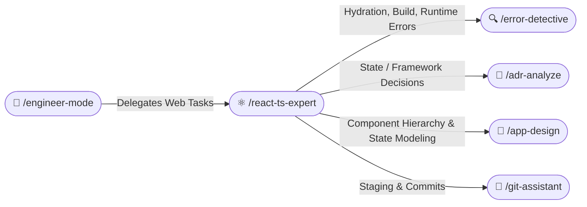
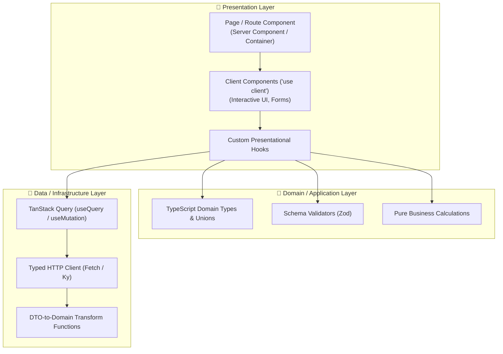

# ⚛️ React + TypeScript Expert Skill (/react-ts-expert)

The **React + TypeScript Expert Skill** is the comprehensive master standard for enterprise modern web engineering. It unifies strict type safety, modular frontend Clean Architecture, reactive data synchronization, accessible design systems, and web performance optimization into a single cohesive framework.

---

## 🧭 Connected Skills & Inter-Skill Routing



### Routing Rules:
1. **Error Diagnostics**: If build errors, TypeScript type check failures, or runtime React exceptions occur, route to `/error-detective`.
2. **Architecture Decisions**: When introducing dependencies (e.g. TanStack Query vs SWR, Zustand vs Redux Toolkit) or changing routing strategies, document via `/adr-analyze`.
3. **System Modeling**: For complex state machines or large component hierarchies, generate diagrams via `/app-design`.
4. **Shipping**: When verified with tests, commit and push via `/git-assistant`.

---

## 🏛️ 1. Frontend Clean Architecture



### Layer Boundary Rules:
- **Presentation Layer**:
  - Keep components dumb and focused on rendering. Delegate complex state transitions and side effects to custom hooks.
  - In Next.js App Router: Default to **React Server Components (RSC)**. Apply `'use client'` only to leaf interactive components.
- **Domain Layer**:
  - Pure TypeScript. No framework-specific DOM manipulation.
  - Model business rules and state machines using discriminated unions and branded types.
- **Data Layer**:
  - Encapsulate all API routes and data fetching inside dedicated `/services/` or `/api/` modules.
  - Always validate incoming API payloads using schema validators (Zod) and map DTOs to clean domain models.

---

## 🛡️ 2. Strict TypeScript Discipline (Zero-Any Policy)

### No `any` Allowed
- Prohibit `any`. Use `unknown` with runtime type narrowing, type predicates, or Zod schemas.
- Use `satisfies` to validate types without widening literal types:
  ```typescript
  const routes = {
    home: '/',
    checkout: '/checkout',
  } satisfies Record<string, string>;
  ```

### Discriminated Unions for UI State
- Never represent asynchronous states with disjoint boolean flags like `isLoading`, `isError`, `isSuccess`.
- Model states as mutually exclusive discriminated unions:
  ```typescript
  export type AsyncState<T> =
    | { readonly status: 'idle' }
    | { readonly status: 'loading' }
    | { readonly status: 'success'; readonly data: T }
    | { readonly status: 'error'; readonly error: Error };
  ```

### Exhaustive Pattern Matching
- Implement an exhaustive check helper to ensure all union variants are handled:
  ```typescript
  export function assertNever(x: never): never {
    throw new Error(`Unhandled union member: ${JSON.stringify(x)}`);
  }
  ```

---

## ⚡ 3. Reactive State Management: TanStack Query & Zustand

- **Server State (TanStack Query)**:
  - Use `useQuery` with structured `queryKey` tuples (e.g. `['users', userId]`).
  - Configure intentional `staleTime` (e.g. 5 minutes) to prevent aggressive background refetching.
  - Use `useMutation` with `queryClient.invalidateQueries()` or optimistic updates for instantaneous UI feedback.
- **Client State (Zustand)**:
  - Keep global store slices small and focused.
  - Select atomic state slices via selector functions (`useCartStore((state) => state.items)`) to eliminate redundant re-renders.

---

## 🎨 4. Modern Styling & Design Systems

- Use **Tailwind CSS** or CSS Modules with mobile-first responsive breakpoints (`sm:`, `md:`, `lg:`, `xl:`).
- Enforce design tokens for spacing, typography, and color palette.
- Support Dark Mode natively via CSS variables or `dark:` variants.

---

## ♿ 5. Accessibility (WCAG 2.2 AA Standard)

- **Semantic HTML**: Use native semantic tags (`<button>`, `<header>`, `<main>`, `<nav>`, `<dialog>`) instead of clickable `<div>` elements.
- **Keyboard Navigation**: All interactive elements must support `Tab`, `Enter`, `Escape`, and arrow navigation with visible focus rings (`focus-visible:ring-2`).
- **ARIA Attributes**: Provide `aria-label`, `aria-expanded`, and `aria-live` where dynamic content updates occur.

---

## 🚀 6. Core Web Vitals & Performance

- **Largest Contentful Paint (LCP)**: Prioritize hero images using `fetchpriority="high"` and Next.js `<Image priority />`.
- **Interaction to Next Paint (INP)**: Defer non-critical calculations using `startTransition` or Web Workers.
- **Cumulative Layout Shift (CLS)**: Explicitly set `width` and `height` aspect ratios on all media and layout containers.
- **Code Splitting**: Dynamically import heavy libraries or secondary dialogs using `React.lazy()` or `next/dynamic`.
