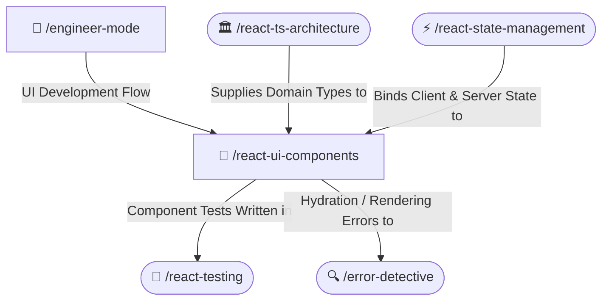

# 🎨 Modular React UI Components Skill

Enforces accessible, high-performance UI components in React 19 and Next.js. Strictly mandates modular file separation (never 1 giant file), prop parameter ordering (mandatory data/callbacks top, optional styling/className bottom), Tailwind CSS hygiene, and WCAG 2.2 AA accessibility.

---

## 🧭 Connected Skills Architecture



---

## 📂 Subfolder Structure

| Path | Purpose | Description |
| :--- | :--- | :--- |
| [`SKILL.md`](./SKILL.md) | Agent Skill Definition | Core instructions and rules for the agent. |
| [`instructions/guidelines.md`](./instructions/guidelines.md) | Agent Execution Protocol | Modular file limits, accessibility checks, and prop order conventions. |
| [`instructions/examples.md`](./instructions/examples.md) | Production Code Examples | Accessible cards, accessible button patterns, and call-site prop ordering. |

---

## 🚀 How to Use

### 1. Direct Skill Activation
Trigger this skill whenever writing new React components, converting monolithic UI files, or fixing accessibility violations:
```text
/react-ui-components
```

### 2. Guided via Engineer Mode
Start through the adaptive interactive questionnaire:
```text
/engineer-mode
```
Select **Playbook 03 (React + TypeScript Engineering)**.

---

## 🔗 Related Skills

- [🏛️ React Clean Architecture](../react-ts-architecture/README.md)
- [⚡ React State Management](../react-state-management/README.md)
- [🧪 React Testing](../react-testing/README.md)
- [🔍 Error Detective](../../diagnostic-skills/error-detective/README.md)
- [🏠 Master Suite README](../../README.md)
