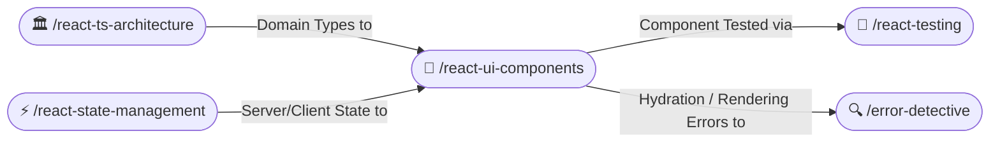

# 🎨 Modular React UI Components (/react-ui-components)

The **React UI Components Skill** sets production standards for accessible, high-performance UI components in React 19 and Next.js. It enforces clean component file decomposition, structured prop interfaces, Tailwind CSS design token hygiene, and WCAG 2.2 AA accessibility.

---

## 🧭 Connected Skills & Routing



---

## 📂 1. Modular File Separation (Never in a Single File)

Never combine a complete route/page, multiple child cards, forms, modals, and helper utilities into a single massive 600-line file. Always decompose features into dedicated, modular files:

```
features/cart/
├── CartPage.tsx               # Next.js Server Component (Route & metadata)
├── CartContainer.tsx          # Client component managing user interactions
├── CartTypes.ts               # Component-specific UI prop models
├── hooks/
│   └── useCartCalculations.ts # Extracted UI calculation logic
└── components/
    ├── CartItemCard.tsx       # Isolated cart item presentation
    ├── CartItemQuantity.tsx   # Quantity stepper control
    └── CartSummaryBar.tsx     # Sticky checkout footer bar
```

---

## 📐 2. The Prop Ordering Rule (Mandatory)

Just like in modern declarative standards, keep props organized predictably:

### Rule A: In the Component Interface & Signature
Mandatory data and event callback props MUST appear **at the top**. Optional configuration, `className`, and `children` must appear **at the bottom**:

```typescript
/** Props for the [CartItemCard] component. */
export interface CartItemCardProps {
  // 1. Mandatory Data Props (Top)
  item: CartItemModel;
  // 2. Mandatory Callback Props
  onQuantityChange: (itemId: string, quantity: number) => void;
  onRemoveItem: (itemId: string) => void;
  // 3. Optional Configuration Props
  isHighlighted?: boolean;
  disabled?: boolean;
  // 4. Optional Styling & Slots (Bottom)
  className?: string;
  children?: React.ReactNode;
}

/**
 * Renders an accessible cart item card with quantity adjustment.
 */
export function CartItemCard({
  item,
  onQuantityChange,
  onRemoveItem,
  isHighlighted = false,
  disabled = false,
  className = '',
  children,
}: CartItemCardProps) {
  return (
    <article
      aria-label={`Cart item: ${item.title}`}
      className={`flex items-center justify-between p-4 rounded-xl border transition-colors ${
        isHighlighted ? 'border-blue-500 bg-blue-50/50 dark:bg-blue-950/20' : 'border-gray-200 dark:border-gray-800'
      } ${className}`}
    >
      {/* Implementation */}
      {children}
    </article>
  );
}
```

### Rule B: At the Call Site / Consumption
Pass data and event handlers first; place long `className` layout styling at the **very bottom of the component tag**:

```tsx
// ✅ Call Site: Data first, className and layout at the VERY BOTTOM
<CartItemCard
  item={cartItem}
  onQuantityChange={(id, qty) => updateQuantity(id, qty)}
  onRemoveItem={(id) => removeItem(id)}
  isHighlighted={cartItem.isPending}
  className="w-full max-w-2xl mx-auto shadow-sm hover:shadow-md transition-shadow"
/>
```

---

## ♿ 3. Accessibility Standards (WCAG 2.2 AA)

1. **Semantic HTML**: Use native `<button>`, `<article>`, `<nav>`, and `<dialog>` tags instead of un-styled `<div>` elements with `onClick`.
2. **Keyboard Navigation & Focus Rings**: Ensure all interactive elements have visible focus outlines (`focus-visible:ring-2 focus-visible:ring-offset-2`).
3. **Screen Reader Attributes**: Add `aria-label`, `aria-expanded`, and `aria-live` where dynamic asynchronous updates take place.
